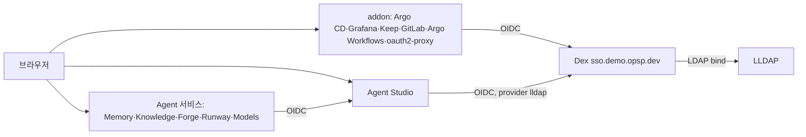

# dex

플랫폼 로그인(OIDC issuer)이다. 모든 addon과 Agent Studio가 이 issuer의 client이고, Agent 서비스(Memory·Knowledge·
Forge·Runway·Models)는 Agent Studio를 거쳐 로그인한다. 한 번 로그인하면 세션이 끝날 때까지 어느 서비스도 다시 묻지 않는다.
namespace는 `addon-dex`, 주소는 `https://sso.demo.opsp.dev`다. upstream chart `dex/dex`를 dependency로 쓴다.

## 로그인 흐름

1. 서비스가 Dex로 보낸다. Dex 세션이 없으면 LLDAP 이메일·비밀번호 폼을 보인다(connector `lldap` 하나).
2. 로그인하면 Dex가 세션 cookie(`dex_session`, `sso.demo.opsp.dev`)를 둔다. 다른 client가 보내면 폼 없이 바로 돌아간다
   (`sessions.ssoSharedWithDefault: all`).
3. 세션은 로그인 후 `dex.session.absolute_lifetime`(7일), 사용하지 않은 채 `dex.session.idle`(24시간)이 지나면 끝난다
   (`env/<cluster>.yaml`). refresh token도 같은 기한을 따른다.
4. 권한은 claim `groups`(LLDAP 그룹)로 정한다: `sso.admin_groups`는 관리자, `sso.member_groups`는 일반 사용자.

## 저장소와 가용성

- storage는 Kubernetes(Dex CRD, `addon-dex`)다. 세션·refresh token·서명 키가 Pod 재시작과 노드 교체 뒤에도 남는다.
  Dex가 처음 시작할 때 CRD를 만든다(`rbac.createClusterScoped`).
- 2 replicas, PDB `maxUnavailable: 1`, 노드 분산. 두 Pod가 같은 storage를 쓴다.
- 세션 기능은 Dex v2.46의 실험 기능이다(`DEX_SESSIONS_ENABLED=true`). Dex를 올릴 때 release note의 sessions 변경을 확인한다.

## Client

| client | 서비스 | secret(SSM) |
| --- | --- | --- |
| `argo-cd` | Argo CD | `/k8s/common/argocd/oidc-client-secret` |
| `argo-cd-cli` | `argocd login --sso`(public, `http://localhost:8085/auth/callback`) | 없음 |
| `argo-workflows-sso` | Argo Workflows | `/k8s/common/argo-workflows-client-secret` |
| `oauth2-proxy-sso` | oauth2-proxy | `/k8s/common/oauth2-proxy-client-secret` |
| `keep-sso` | Keep | `/k8s/common/keep/oidc-client-secret` |
| `gitlab-sso` | GitLab | `/k8s/common/gitlab/oidc-client-secret` |
| `grafana-sso` | Grafana | `/k8s/common/grafana/oidc-client-secret` |
| `jenkins-sso` | Jenkins(보관) | `/k8s/common/jenkins/oidc-client-secret` |
| `agent-studio` | Agent Studio(`argocd-env-apps`, provider ID `lldap`) | `/k8s/<cluster>/agent-studio/oidc-client-secret` |

- secret은 ExternalSecret `dex-secret`이 환경 변수로 넣는다(`secretEnv`). 같은 값을 각 서비스가 읽는다.
  `install/eks/secrets.sh`가 없는 값을 만든다. 하나라도 없으면 `dex-secret` 전체가 갱신되지 않는다.
- Dex는 시작할 때 secret을 읽는다. 값을 바꾸면 `dex-secret`이 갱신된 뒤 `kubectl -n addon-dex rollout restart deploy/dex`를 실행한다.
- client를 추가하면 이 표, `values-template.yaml.j2`의 `staticClients`·`dex-secret`, `secrets.sh`를 함께 바꾼다.

## 로그아웃

각 서비스의 로그아웃은 그 서비스 세션만 끝낸다. Dex 세션은 기한까지 남으므로 다른 서비스는 계속 로그인 상태다.

다른 계정으로 바꾸려면 Dex 세션을 끝낸다.

1. `https://sso.demo.opsp.dev/logout`을 열고 로그아웃을 확인한다. Dex 세션과 그 세션의 refresh token이 끝난다
   (OIDC RP-Initiated Logout, discovery의 `end_session_endpoint`).
2. 계정을 바꿀 서비스에서 로그아웃한다. 서비스 세션은 Dex와 따로 남아 있기 때문이다.
3. 다시 로그인하면 Dex가 이메일·비밀번호 폼을 보인다.
